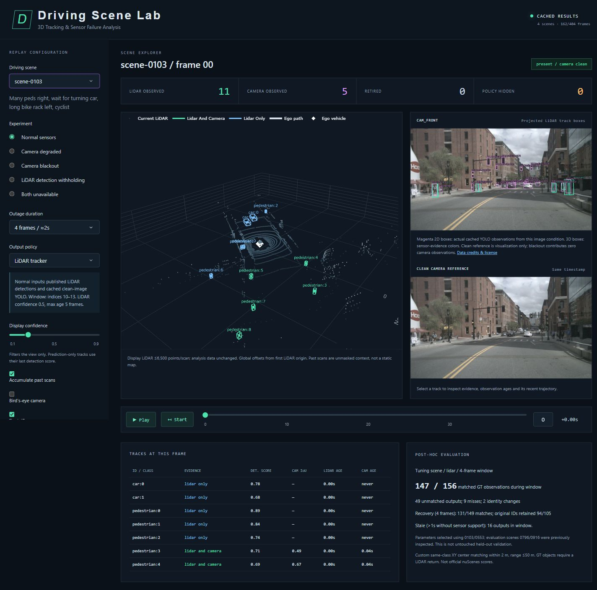

# Driving Scene Lab — 3D Tracking & Sensor Failure Analysis

This hosts the **original recorded Driving Scene Lab replay**, with actual CAM_FRONT photographs and recorded LiDAR from nuScenes mini scenes **0103, 0553, 0796 and 0916**, all 162 covered frames. It replays the saved CenterPoint/SimpleTrack results and locally generated YOLO observations. No road or object is procedurally generated, and no detector runs live.

Live application: https://driving-scene-lab.onrender.com/ . Full research history: https://github.com/AhireRohit/driving-scene-lab . `SOURCE.json` pins the source and asset-manifest hash. Internal Python package names remain unchanged.

`recorded_bundle` includes calibration/timestamps, 60 original scenario caches, 486 camera packets, resized photographs and degraded versions, sampled recorded point clouds, original baseline records and evaluation summaries. Display images are width 960, JPEG quality 85; point clouds use the original viewer's stride with at most 6,500 real points per scan. No frames or scenes were removed. Tracking/evidence/benchmark values are unchanged. Clean reference photos are display-only during blackout.

**Data terms and attribution:** nuScenes / Motional AD Inc. and affiliates; Caesar et al., CVPR 2020. Non-commercial recorded data derivatives are CC BY-NC-SA 4.0 plus https://www.nuscenes.org/terms-of-use . See [full data credits, changes and terms](recorded_bundle/DATA_LICENSE.md). Source detections: [MCTrack publisher](https://github.com/megvii-research/MCTrack), labelled CenterPoint; tracker: [SimpleTrack](https://github.com/tusen-ai/SimpleTrack); camera detector: [Ultralytics YOLO11s](https://github.com/ultralytics/ultralytics). No endorsement is implied. Detector checkpoint/sweeps/training overlap remain unspecified. No models, weights, training environment, full dataset or GT annotation table are bundled.

Install `pip install -r requirements-demo.txt`, then run `gunicorn --bind 0.0.0.0:$PORT --workers 1 --threads 4 --timeout 120 app:server`. The legacy requirements filename is retained. `render.yaml` selects the free plan; free instances may sleep. `/healthz` reports `recorded-replay`, four scenes and 162 frames. Missing/corrupt assets produce an explicit 503 configuration error, never procedural content. A Dockerfile is included.

Verified 3 November 2026: 39 local tests and 46 live HTTP cases passed. Browser scene selection, playback/pause, scrubbing, BEV, track inspection, outage and recovery were checked. [Verification](docs/release/recorded_deployment_verification.json) · [Deployment details](docs/DEPLOYMENT.md).

